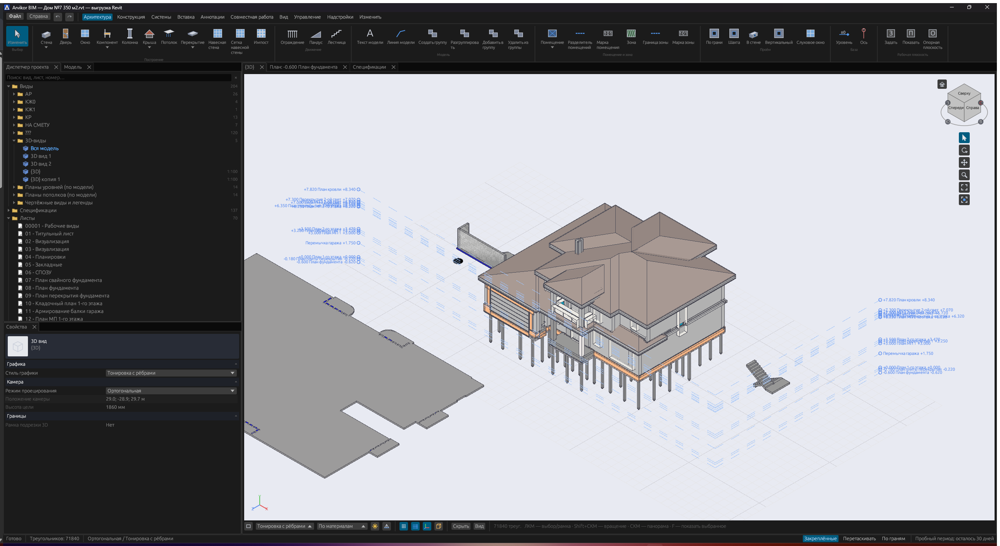
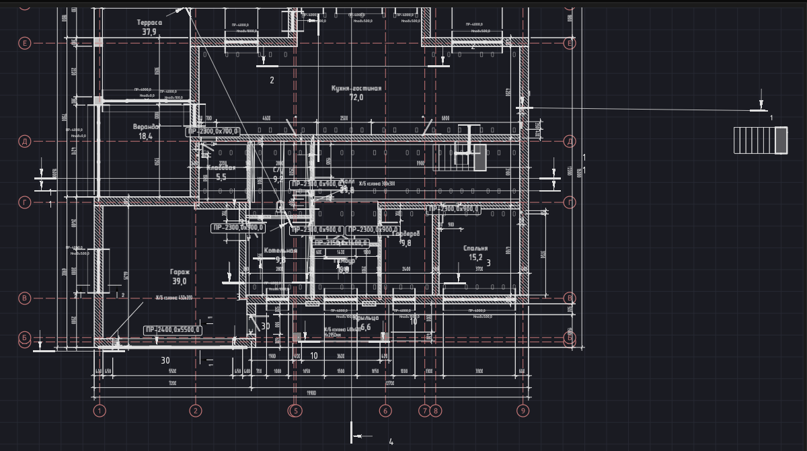
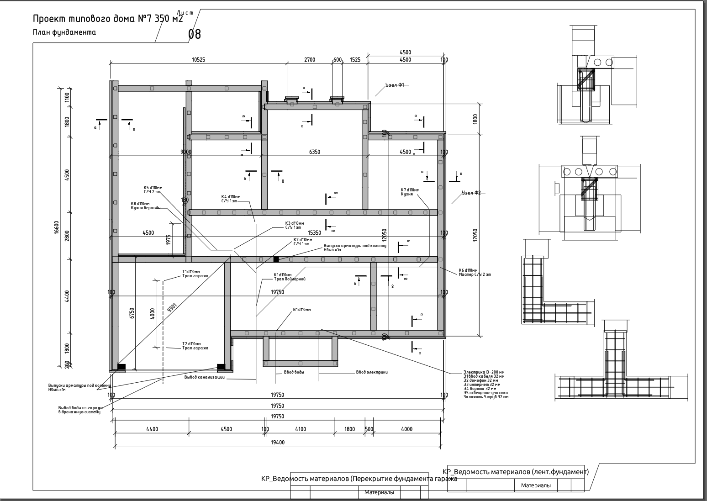
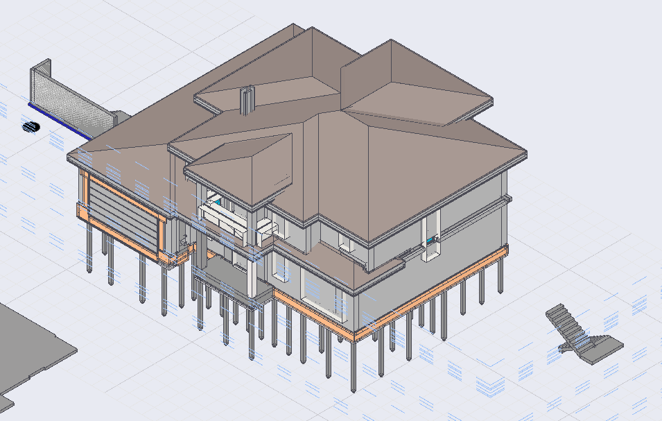
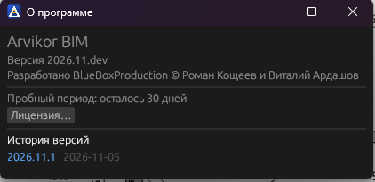

# Arvikor BIM

**Arvikor BIM** — настольная BIM-программа для архитектурного и конструктивного проектирования.
Работает без интернета и без Autodesk: открывает модели Revit (.rvt), даёт править их родными элементами
и выпускать документацию — планы, разрезы, листы, спецификации — в PDF, DXF и IFC.

## Возможности

- **Импорт .rvt без Revit.** Стены, перекрытия, колонны, балки, крыши, лестницы, двери, окна, помещения
  с марками, мебель становятся редактируемыми элементами Arvikor, с типами, слоями и материалами.
- **План как в Revit.** Веса линий по перьям и масштабу, штриховки разреза по уровню детализации, графика
  дверей и мебели из семейств, «Видимость/графика» вида, стили объектов, диапазон и глубина вида.
- **Аннотации.** Тексты, размеры по типам Revit, марки, линии детализации, области, символы на планах,
  разрезах и фасадах; чертёжный шрифт ГОСТ.
- **Листы и выпуск документации.** Видовые экраны, спецификации, основная надпись; экспорт листов в PDF и DXF,
  плана — в DXF, SVG, PDF; модели — в IFC4 для любого BIM-софта.
- **Редактор.** Стены прямые и дуговые, ручки и временные размеры как в Revit 2024, армирование,
  перемычки по ГОСТ 948-84, инженерные трассы с фитингами, семейства и типы.
- **Совместная работа** через свой сервер в локальной сети — без облака.
- **Автообновление.** Программа сама сообщает о новой версии; обновление в один щелчок.

## Системные требования

| | Минимум | Рекомендуется |
|---|---|---|
| Система | Windows 10 x64 (1809+) | Windows 11 x64 |
| Процессор | 4 ядра x64 | 8 ядер и больше |
| Память | 8 ГБ | 16–32 ГБ (большие модели .rvt) |
| Видеокарта | DirectX 12 или Vulkan | дискретная, 4 ГБ видеопамяти |
| Диск | 500 МБ + место под проекты | SSD |

Revit не нужен. Интернет нужен только для проверки обновлений и онлайн-активации лицензии — всё остальное
работает без сети (лицензию можно активировать и офлайн).
Linux x64 — пробная сборка (архив `Arvikor-<версия>-linux-x64.tar.gz`).

## Установка

1. Откройте [последний релиз](../../releases/latest).
2. Скачайте `ArvikorBIM-Setup-<версия>.exe` и запустите. Права администратора не нужны: программа ставится
   в `%LOCALAPPDATA%\Programs\Arvikor` для текущего пользователя.
3. Запустите **Arvikor BIM** из меню «Пуск» или с рабочего стола.

Без установщика: распакуйте `Arvikor-<версия>-windows-x64.zip` в любую папку, куда у вас есть право записи,
и запустите `arvikor.exe`.

Контрольные суммы — в файлах `*.sha256` рядом с архивами
(`Get-FileHash Arvikor-<версия>-windows-x64.zip -Algorithm SHA256`).

### Обновление

Программа проверяет обновления через 15 секунд после запуска и раз в 6 часов (отключается в
«Параметры → Общие → Обновления»), вручную — «Справка → Проверить обновления». Если вышла новая версия,
в углу окна появится «Доступна версия X»: «ChangeLog» показывает, что нового, «Обновить» скачивает пакет,
предлагает сохранить проект, ставит новую версию и запускает программу снова. Прежние файлы остаются
в `.update-backup` в папке программы до следующего обновления; если установка не удалась, всё
возвращается как было. Журнал — `%LOCALAPPDATA%\Arvikor\logs\updater.log`.

## Лицензия и пробный период

Arvikor BIM — коммерческая программа. После первого запуска 30 дней работает пробный период со всеми
возможностями; дальше для работы нужна лицензия. Лицензия привязывается к одному компьютеру и активируется
в «Справка → Лицензия…»: онлайн — по ключу `ARVK-…`, офлайн — по коду запроса и длинному ключу от нас.
Проект можно сохранить всегда, даже когда срок вышел. По вопросам лицензии — через «Обратную связь» ниже.

## Обратная связь

- Ошибки и предложения — [Issues](../../issues) этого репозитория: что делали, что ожидали, что получили;
  приложите снимок экрана и, если можно, файл модели.
- При падении программы приложите `crash.log` из `%APPDATA%\Arvikor\rs` и `updater.log`
  из `%LOCALAPPDATA%\Arvikor\logs`.

В этом репозитории — только выпуски программы и это описание.

---

Разработано **BlueBoxProduction** © Роман Кощеев и Виталий Ардашов
